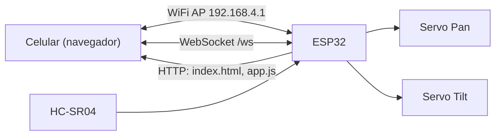

# DESIGN

## Objetivo

Robot con ruedas controlado desde el celular por WiFi (joystick + cámara en vivo), construido de forma incremental. Esta primera fase valida la cadena completa **sensor → ESP32 → web** y **web → ESP32 → actuadores** con 2 servos.

## Arquitectura (Fase 1)

## Decisiones

| Decisión | Elección | Motivo |
|---|---|---|
| Red | ESP32 como Access Point | Funciona sin router, en cualquier lugar |
| Web | HTML/CSS/JS vanilla en LittleFS | Sin build, sin internet, fácil de iterar |
| Comunicación | WebSocket con texto simple | Baja latencia, bidireccional (comandos + telemetría) |
| Firmware | Arduino IDE + ESPAsyncWebServer + ESP32Servo | Pedido del proyecto; simple y bien documentado |
| Protocolo | Texto plano `S:pan,tilt` / `D:cm` | Parseo trivial, sin librería JSON |
| Seguridad | WPA2 en el AP, valores limitados con `constrain` | Red local, uso personal |

## ¿WiFi o Bluetooth?

**WiFi** (elegido). El ESP32 crea la red `ESP32-Robot`; el celular se conecta y abre `http://192.168.4.1` en el navegador, que descarga la página y abre un WebSocket contra el ESP32.

| | WiFi (AP + WebSocket) | Bluetooth (BLE / Classic) |
|---|---|---|
| App en el celular | Ninguna, alcanza el navegador | Requiere app o Web Bluetooth (solo Chrome Android, no iOS) |
| Video de cámara | Sí (stream MJPEG) | No, el ancho de banda no alcanza |
| Latencia / alcance | Baja, ~30–50 m en abierto | Baja, ~10 m |
| Consumo | Mayor | Menor |
| Interfaz | Página propia (joystick personalizado) | Limitada |

La cámara decide: sin WiFi no hay video en vivo. Bluetooth quedaría solo como extra (ej. joystick físico), no como canal principal.

**Cómo se vincula, paso a paso:**
1. El ESP32 enciende y publica la red WiFi (SSID/clave en `config.h`).
2. El celular se conecta a esa red (no tendrá internet mientras tanto; Android puede preguntar si mantener la conexión: decir que sí).
3. En el navegador: `http://192.168.4.1` → el ESP32 entrega `index.html`, `style.css` y `app.js` desde LittleFS.
4. `app.js` abre `ws://192.168.4.1/ws`. Por ahí viajan los comandos (`S:pan,tilt`) y la telemetría (`D:cm`). Si se corta, reconecta solo cada 2 s.

## Interfaz horizontal

Pensada para usar con ambos pulgares con el celular en horizontal, sin scroll: izquierda joystick, centro estado/cámara/distancia, derecha ajustes finos. En vertical se muestra un aviso para girar el celular. Cuando se sumen los motores, la columna derecha pasará a ser un segundo joystick (movimiento) y el de la izquierda quedará para la cabeza.

## Flujo de datos

- **Cliente → ESP32:** el joystick envía `S:<pan>,<tilt>` cada 50 ms como máximo, solo si cambió.
- **ESP32 → Cliente:** cada 200 ms difunde `D:<cm>` (`-1` = sin eco).

## Consideraciones de hardware

- Los servos se alimentan con 5V externos, **no** desde el pin 3V3 del ESP32; GND común.
- El pin ECHO del HC-SR04 entrega 5V: usar divisor resistivo (1kΩ / 2kΩ) hacia el GPIO.
- Capacitor (470–1000 µF) en la alimentación de servos para evitar reinicios por picos.

## Alimentación (una sola batería)

Una celda 18650 (3.7V, hasta 4.2V) sola **no alcanza** para motores + servos + ESP32: baja de 3.3V al descargarse y los picos de los motores reinician el ESP32. Opciones:

| Opción | Detalle | Recomendación |
|---|---|---|
| 2x18650 en serie (7.4V) + buck 5V (≥3A) | Motores DC desde el L298N (7.4V), ESP32 y servos desde el buck | Recomendada |
| 1x18650 + boost a 5V (≥2A) | Más simple, menos autonomía y potencia | Para pruebas |

Reglas: GND común, capacitores cerca de servos/motores, y proteger la batería (BMS/TP4056 con protección). Los 4 motores van a 2 canales del L298N (lado izquierdo en paralelo, lado derecho en paralelo).

## Evolución prevista

Ver [ROADMAP.md](ROADMAP.md). Al pasar a **ESP32-CAM** habrá pocos GPIO libres: se evaluará un segundo ESP32 (control) comunicado con el ESP32-CAM (video), o un expansor de GPIO. El protocolo WebSocket está pensado para extenderse con nuevos prefijos (`M:` motores, `B:` buzzer).

## Interfaz web

Una sola pantalla, mobile-first: joystick circular (Pointer Events, funciona con touch y mouse), indicador de conexión con reconexión automática, lectura de distancia, botón de centrar.
