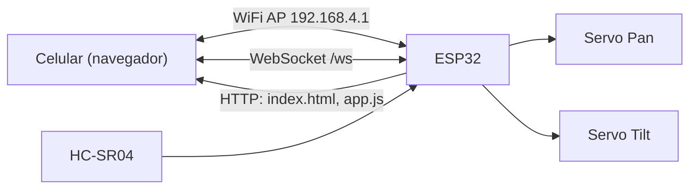

# DESIGN

## Objetivo

Robot con ruedas controlado desde el celular por WiFi (joystick + cámara en vivo), construido de forma incremental. Esta primera fase valida la cadena completa **sensor → ESP32 → web** y **web → ESP32 → actuadores** con 2 servos.

## Arquitectura (Fase 1)

## Decisiones

| Decisión | Elección | Motivo |
|---|---|---|
| Red | ESP32 como Access Point | Funciona sin router, en cualquier lugar |
| Web | HTML/CSS/JS vanilla en LittleFS | Sin build, sin internet, fácil de iterar |
| Comunicación | WebSocket con texto simple | Baja latencia, bidireccional (comandos + telemetría) |
| Firmware | Arduino IDE + ESPAsyncWebServer + ESP32Servo | Pedido del proyecto; simple y bien documentado |
| Protocolo | Texto plano `S:pan,tilt` / `D:cm` | Parseo trivial, sin librería JSON |
| Seguridad | WPA2 en el AP, valores limitados con `constrain` | Red local, uso personal |

## Flujo de datos

- **Cliente → ESP32:** el joystick envía `S:<pan>,<tilt>` cada 50 ms como máximo, solo si cambió.
- **ESP32 → Cliente:** cada 200 ms difunde `D:<cm>` (`-1` = sin eco).

## Consideraciones de hardware

- Los servos se alimentan con 5V externos, **no** desde el pin 3V3 del ESP32; GND común.
- El pin ECHO del HC-SR04 entrega 5V: usar divisor resistivo (1kΩ / 2kΩ) hacia el GPIO.
- Capacitor (470–1000 µF) en la alimentación de servos para evitar reinicios por picos.

## Evolución prevista

Ver [ROADMAP.md](ROADMAP.md). Al pasar a **ESP32-CAM** habrá pocos GPIO libres: se evaluará un segundo ESP32 (control) comunicado con el ESP32-CAM (video), o un expansor de GPIO. El protocolo WebSocket está pensado para extenderse con nuevos prefijos (`M:` motores, `B:` buzzer).

## Interfaz web

Una sola pantalla, mobile-first: joystick circular (Pointer Events, funciona con touch y mouse), indicador de conexión con reconexión automática, lectura de distancia, botón de centrar.
